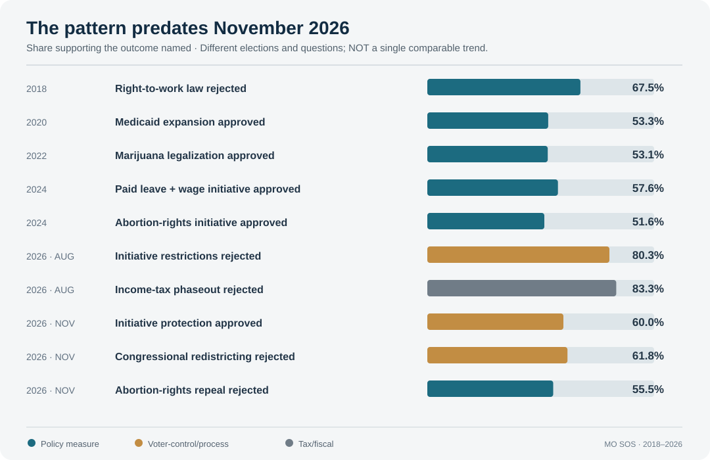
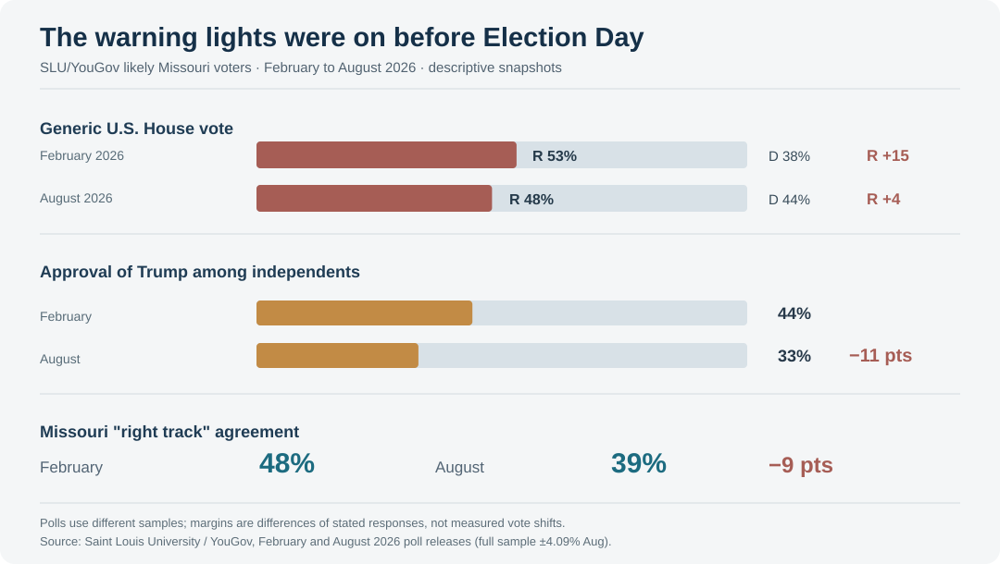

> **AI-generated, sourced case study — November 4, 2026, post-election snapshot.** Election results are unofficial pending certification. This is an analytical reconstruction, not firsthand reporting, and not a forecast of the 2028 winner. The causal arguments below are *hypotheses tested against available evidence*, not proven voter-level causes. See [methodology](../../METHODOLOGY.md) and [corrections](../../CORRECTIONS.md).

# Missouri's Warning Lights Were Flashing Long Before Election Night

*An HBR-style political case study: how repeated citizen referendums, a shrinking partisan cushion and suburban erosion preceded the 2026 midterm shift—and what evidence could determine whether it lasts.*

**November 4, 2026 · Independent analysis · Missouri case study**

## The executive proposition

Missouri's November election was consequential not simply because Democrats flipped **16 Republican state House seats**, leaving the chamber **95 Republicans to 68 Democrats**, or because they erased Republican supermajorities in both chambers while taking Missouri's second congressional district. Those are **outcomes**. The more useful research question is whether they were visible in advance—and whether Missouri offers a way to understand a changing national political environment.

The evidence suggests two overlapping **mechanisms worth testing**, not one all-purpose explanation:

1. **A long-running conflict over voter control of policy.** Since at least 2018, Missourians have repeatedly used statewide votes to accept some policies at odds with Republican legislative priorities, or to resist alterations to measures enacted directly by voters. In 2025 the legislature reversed major portions of a voter-approved paid-sick-leave law; in August 2026 voters overwhelmingly rejected new restrictions on citizen initiatives; in November they protected that process constitutionally.
2. **A measurable change in the national-party environment, then in local candidate results.** Between February and August 2026, a Saint Louis University/YouGov survey registered an **11-point contraction** in the Republican lead on the generic U.S. House ballot, an **11-point fall** in Trump's approval among independents, and sharply negative views of economic performance. In November, suburban legislative seats and Ann Wagner's congressional district shifted.

Both patterns matter. Their relationship is not settled. A referendum voter who rejects a legislature-backed constitutional amendment is not necessarily the same individual who crosses party lines for a Democrat. Nor does a statewide survey identify the reasons for a particular district's result.

**The case-study question for 2027 is whether those two forces continue moving together—or diverge again as they did in 2018.**

## Exhibit 1 — The policy signal is older than the electoral swing

*Exhibit note: The percentage on each row is the share that supported the **named outcome** (sometimes a “No” vote); these are distinct elections and ballot questions. Connecting them with a trend line or calculating their average would be misleading. Refer to the [Missouri secretary of state's historical results](https://www.sos.mo.gov/elections/s_default/results), the [2018 ballot explanation](https://www.sos.mo.gov/elections/petitions/2018ballotmeasures), and the [2026 official ballot titles](https://www.sos.mo.gov/petitions/2026ballotmeasures).*

In **2018**, voters rejected a right-to-work law at a roughly two-thirds margin. In that same election cycle, a statewide Democratic wave did **not** end Missouri Republicans' legislative supermajorities. Republican candidates could still win even when voters rejected an important Republican policy position.

In **2020**, voters narrowly approved Medicaid expansion. In **2022**, they approved recreational marijuana legalization. In **2024**, they approved an increase in the minimum wage with paid sick leave as well as constitutional abortion protections, while also electing Republicans statewide. These disparate measures share a structural feature: voters could make a specific policy choice without changing the party governing Jefferson City.

The 2024 paid-sick-leave initiative became a potential hinge point. **Proposition A passed with about 58% support**, establishing a wage schedule and paid-leave requirements. In **July 2025**, Republican Gov. Mike Kehoe signed **HB 567**, which removed the paid-sick-leave mandate and future automatic inflation increases for the minimum wage, while retaining the scheduled $15 minimum wage. Supporters of the repeal emphasized employer burdens and implementation costs; opponents emphasized reversing a direct electoral decision. The [statutory change is documented by Ballotpedia](https://news.ballotpedia.org/2025/07/11/missouri-governor-signs-law-repealing-provisions-of-2024-paid-sick-leave-and-minimum-wage-ballot-initiative/) and [the 2024 ballot description by Missouri's secretary of state](https://www.sos.mo.gov/elections/petitions/2024BallotMeasures).

That episode supplies a **specific, testable pathway**: policy disagreement became a process disagreement about whether legislators should be able to revise decisions made directly by voters.

The clearest early warning came **August 4, 2026**, before November's general election. In the statewide primary, **80.3% voted against Amendment 4**, which sought to alter rules for citizen initiatives; **83.3% voted against Amendment 5**, a proposed tax restructuring involving a conditional income-tax phaseout. The [official primary results](https://www.sos.mo.gov/CMSImages/ElectionResultsStatistics/2026PrimaryElection.pdf) show 1,125,719 votes against Amendment 4 and 1,168,110 against Amendment 5.

In November, the pattern repeated in multiple but not identical ways: **59.97% approved Amendment 6**, adding stronger constitutional protections for initiatives; **61.84% rejected Proposition A**, the proposed congressional map; **55.49% rejected Amendment 3**, which would have repealed reproductive-rights protections approved in 2024. These are preliminary, all-precinct unofficial tallies, reported from [Missouri secretary-of-state figures](https://www.fultonsun.com/news/2026/nov/04/nov-3-election-results-missouri-amendments-and-propositions/).

These votes are **consistent with** concern about the legislature's power relative to voters. But they do not show that procedural concerns alone caused Democratic seat gains. Amendment 7's defeat, for example, could also reflect concern about fiscal design, while Amendment 8 narrowly passed. Missouri voters were making differentiated decisions.

## Exhibit 2 — The electoral warning was measurable by August

*Source: [SLU/YouGov September 10 release](https://www.slu.edu/news/2026/september/slu-poll.php), based on **900 likely Missouri voters surveyed in August 2026**, full-sample margin of error ±4.09 percentage points. February and August samples are separate cross-sections; individual changes should not be mistaken for panel data.*

Four numbers deserve attention:

- **Republican U.S. House generic-ballot advantage:** **15 points in February (53–38)**, **four points in August (48–44)**. This is an 11-point narrowing in a statewide survey, not a district-level election prediction.
- **Trump approval among independents:** **44% in February**, **33% in August**, an 11-point decline; disapproval among independents reached 66%.
- **Missouri 'right track' sentiment:** **48% agreed in February**, **39% in August**, a nine-point decline, based on SLU's [poll trend data](https://www.slu.edu/research/research-institute/big-ideas/slu-poll/previous-poll-results/august-2026-results.php).
- **Household economics:** In August, at least **59% expressed concern** about affording each of healthcare, groceries, gasoline, utilities and property taxes; **21% rated the national economy excellent or good**. **53% opposed the decision to go to war in Iran**, compared with 35% who approved. These are reported sentiments, not direct causal attributions for election votes.

The same SLU survey measured **48% approval and 52% disapproval of Trump**, **40% approval of Kehoe**, and **42% approval of the Missouri legislature**. Independent respondents preferred the Democratic candidate on a generic state House ballot by **42% to 36%**.

The distinction between *warning* and *prediction* is important. A survey with a ±4.09-point full-sample margin cannot tell which specific districts will flip; subgroup errors are larger. But the combination of a narrower statewide partisan margin, independent-voter movement and negative economic sentiment was observable **months before the election**.

SLU political scientist Steven Rogers also reported a statistical association between disapproval of Trump and support for Democratic state House candidates. That supports a plausible nationalization mechanism, but observational associations cannot demonstrate that changing views of Trump caused individual vote switches.

## Exhibit 3 — The swing reached the electoral map

The outcome was geographically broader than a simple increase in votes in St. Louis City and Kansas City.

[Missouri Independent's November 4 legislative count](https://missouriindependent.com/2026/11/04/democrats-flip-16-missouri-house-seats-ending-republican-supermajority/) documents **16 Republican-to-Democratic House flips and zero Democratic-to-Republican flips**, resulting in **95 Republican / 68 Democratic seats**. Democrats captured **three House districts in St. Charles County**, where they had not won a state House seat in approximately two decades; also an open district in **Cass County** and the downtown **Jefferson City** seat, the latter by **189 votes**. In the Senate, gains in a **Springfield-area district** and in **eastern Jackson County** ended the Republican two-thirds majority.

In **MO-02**, Democrat **Fred Wellman defeated seven-term Republican Ann Wagner**. Wagner's margin in St. Charles County was reduced from about **16,000 votes in 2024** to about **4,000 in 2026**, while Wellman won St. Louis County by about 14 points. The [Missouri Independent's analysis](https://missouriindependent.com/2026/11/04/missouri-republicans-suffer-biggest-electoral-setback-in-a-generation/) documents the comparison.

That is an observable shift in the **suburban Republican cushion**, not evidence that St. Charles voters as a whole now identify as Democratic. Differential turnout, candidate quality, a midterm environment and local issues can all contribute. A fuller explanation would require district and precinct crosswalks normalized for redistricting, turnout and candidate effects.

Missouri also retained substantial Republican strength: Gov. Kehoe remains in office; Republicans retain both legislative majorities; Republican **Scott Fitzpatrick** won reelection as auditor. The data show *less overwhelming Republican control*, not statewide one-party replacement.

## Two mechanisms, a useful counterexample, and competing explanations

### Mechanism A: Voter agency becomes a governing issue

The pathway is plausible: **policy enactment by referendum → legislative revision or attempted replacement → resistance to rule changes → legislative seats become contested**. The 2025 paid-sick-leave repeal and 2026 initiative votes supply a particularly clear sequence.

**Why it may matter:** Missouri's initiative process allows a voter to separate preferences over individual laws from loyalty to a political party. A repeated conflict between popular initiatives and legislative action can make institutional procedure itself a campaign issue.

**Evidence still missing:** survey or precinct-level proof that voters upset by a particular legislative reversal actually changed candidate votes, rather than voting identically in partisan races as before.

### Mechanism B: National discontent flows through the suburbs

The pathway is also plausible: **worsening views of prices and national leadership → weaker Republican support among independents → narrower generic-ballot advantage → contested suburban House and Senate districts**.

**Why it may matter:** Missouri's legislative races are not isolated from presidential approval. SLU's modeling found a statistical association between presidential sentiment and state legislative choice.

**Evidence still missing:** matched individual-level survey panels, validated voter files, county/precinct turnout comparisons and controls for local candidates. None of the polls alone can separate economic anxiety, the Iran war, or generalized incumbent dissatisfaction.

**The counterexample is 2018.** Missourians voted against right-to-work and for several measures associated with organized labor and reform, yet Republican legislative supermajorities survived that year's midterms. That weakens a simplistic claim that victories for progressive-sounding ballot measures must produce Democratic legislative victories.

**Other plausible factors:** a national midterm backlash; candidate recruitment and spending efficiency; the unusually wide array of ballot measures; uncertainty about ballot wording; turnout composition; local issues such as school funding, healthcare access and housing. The 2026 result is compatible with some combination of these, and the relative contributions have not yet been measured.

## Exhibit 4 — The Missouri 2027 observation dashboard

The purpose of monitoring is **not** to predict a party winner. It is to distinguish whether 2026 reflects a temporary national mood, a durable change in the state-level relationship between voters and legislators, or both.

| Observable indicator | Data to collect in 2027 | What a change would help test |
|---|---|---|
| **Citizen-initiative legitimacy** | New bills concerning initiatives; implementation of Amendment 6; litigation and court decisions | Whether conflict over direct democracy remains institutionally salient |
| **Suburban cross-party voting** | Precinct-level comparisons in MO-02 and St. Charles, normalized for turnout and district boundaries; later local elections | Whether 2026's suburban changes were broad or race-specific |
| **Independent sentiment** | Repeated SLU/YouGov or equivalent surveys, with identical question wording and subgroup uncertainty | Whether the 2026 independent-voter shift persists after the midterms |
| **Cost-of-living evaluations** | Household prices, wages, consumer sentiment, utility bills, healthcare costs; longitudinal polling | Whether economic evaluations recover or remain negative |
| **Legislative bargaining** | Veto overrides, emergency clauses, bipartisan roll calls, bills amended or withdrawn | How lost supermajorities change actual governing behavior |
| **Policy delivery** | Implementation of wage law, abortion-rights rules and initiative protections; budget outcomes | Whether voter-enacted policy and legislative administration align |
| **Candidate and turnout structure** | Recruitments, contested districts, turnout by comparable precinct, spending and donor composition | Whether 2026's results reflect candidate supply or unusual participation |

**Suggested cadence:** establish a baseline using certified November 2026 results; review legislative and court actions quarterly in 2027; review statewide opinion only when methodologically comparable new surveys appear; revisit district-level patterns when new elections supply observations.

**Falsification tests:** If citizens continue opposing legislative modifications at the ballot box **but** the Republican suburban vote margin returns to earlier levels, the *policy–candidate linkage* is weaker than it appeared in November. If economic views recover while suburban margins remain narrower, the *economics-only explanation* becomes less sufficient. If neither behavior persists under comparable election conditions, the apparent realignment may have been substantially cyclical.

## What Missouri does—and does not—tell us about 2028

Missouri offers a particularly informative **research setting** because it combines long Republican dominance, repeated issue-specific voter departures from legislative policy, an unusually decisive August 2026 rejection of changes to direct-democracy and tax rules, pre-election polling deterioration, and geographically distributed candidate losses in November.

It does **not** establish that other states will follow the same path, that Democrats will continue gaining seats, or that one or two issues drove every result. Missouri's political geography, ballot initiative system and legislative thresholds are distinctive. A serious national comparison should test similar policy–voter disagreements in other states, not assume Missouri is a representative sample.

The sharper research proposition is this:

> **Missouri may illustrate how a persistent gap between governing institutions and issue-by-issue voter preferences can become electorally visible when a difficult national environment reduces a dominant party's margin for error.**

That is a hypothesis worth preserving—and retesting against 2027 evidence. The 2026 election supplies a striking observation, not the final answer.

---

## Research notes and source trail

**Primary election and legal records**
1. [Missouri secretary of state: election archives and results](https://www.sos.mo.gov/elections/s_default/results).
2. [Missouri secretary of state: August 2026 official primary totals](https://www.sos.mo.gov/CMSImages/ElectionResultsStatistics/2026PrimaryElection.pdf).
3. [Missouri secretary of state: 2018 ballot measure descriptions](https://www.sos.mo.gov/elections/petitions/2018ballotmeasures).
4. [Missouri secretary of state: 2024 ballot measure descriptions](https://www.sos.mo.gov/elections/petitions/2024BallotMeasures).
5. [Missouri secretary of state: 2026 ballot measure descriptions](https://www.sos.mo.gov/petitions/2026ballotmeasures).
6. [Unofficial November 2026 statewide vote counts reproduced from secretary-of-state returns](https://www.fultonsun.com/news/2026/nov/04/nov-3-election-results-missouri-amendments-and-propositions/).

**Polling and research**
7. [Saint Louis University / YouGov, September 10, 2026 release](https://www.slu.edu/news/2026/september/slu-poll.php).
8. [SLU/YouGov August 2026 toplines, trend charts and cross-tabs](https://www.slu.edu/research/research-institute/big-ideas/slu-poll/previous-poll-results/august-2026-results.php).
9. [SLU/YouGov public data archive](https://hr.slu.edu/research/research-institute/big-ideas/slu-poll/data-archive/index.php).

**Post-election reporting and contemporaneous policy coverage**
10. [Missouri Independent: 16 Democratic House pickups, November 4](https://missouriindependent.com/2026/11/04/democrats-flip-16-missouri-house-seats-ending-republican-supermajority/).
11. [Missouri Independent: Missouri election analysis, November 4](https://missouriindependent.com/2026/11/04/missouri-republicans-suffer-biggest-electoral-setback-in-a-generation/).
12. [Missouri Independent: Fred Wellman defeats Ann Wagner, November 3](https://missouriindependent.com/2026/11/03/democrat-fred-wellman-ousts-republican-ann-wagner-in-missouri-congressional-upset/).
13. [Ballotpedia: July 2025 paid-sick-leave repeal](https://news.ballotpedia.org/2025/07/11/missouri-governor-signs-law-repealing-provisions-of-2024-paid-sick-leave-and-minimum-wage-ballot-initiative/).
14. [Missouri Law Review: initiative law and legislative repeal](https://lawreview.missouri.edu/pre-empting-the-people-missouris-legislative-response-to-the-voter-approved-paid-sick-leave-mandate/).

**Limitations:** Percentages in the first graphic represent approval or rejection of distinct measures with different electorate compositions; do not interpret them as a longitudinal vote-share series. Polls are subject to sampling and non-sampling error, and candidate-vote changes across different years combine turnout, nominee and context effects. No causal estimates were calculated for this report. Election totals were unofficial as of the reporting cutoff.
